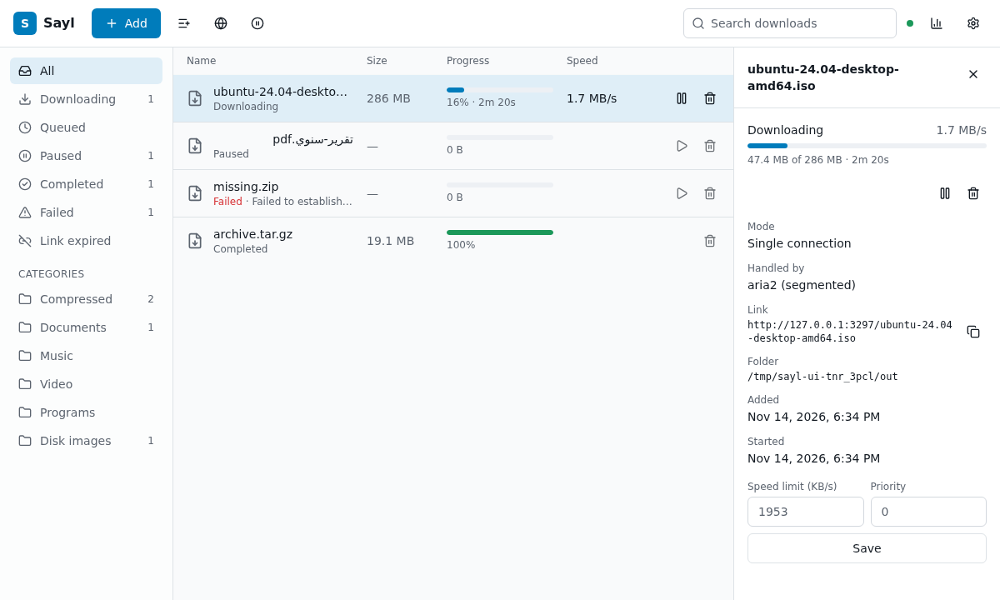
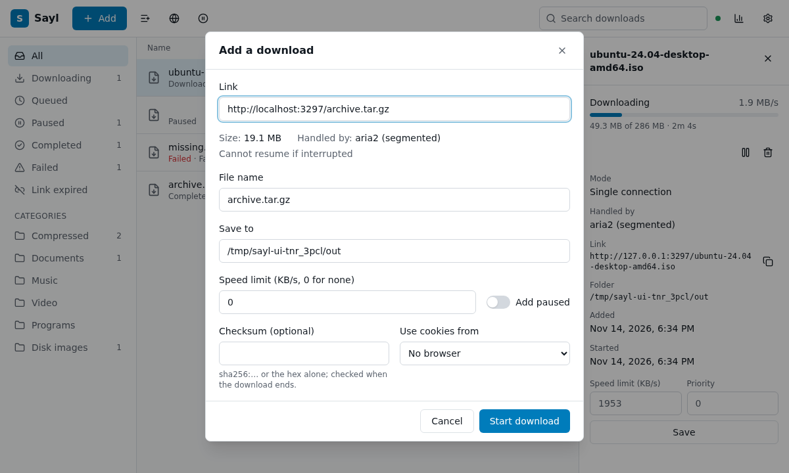
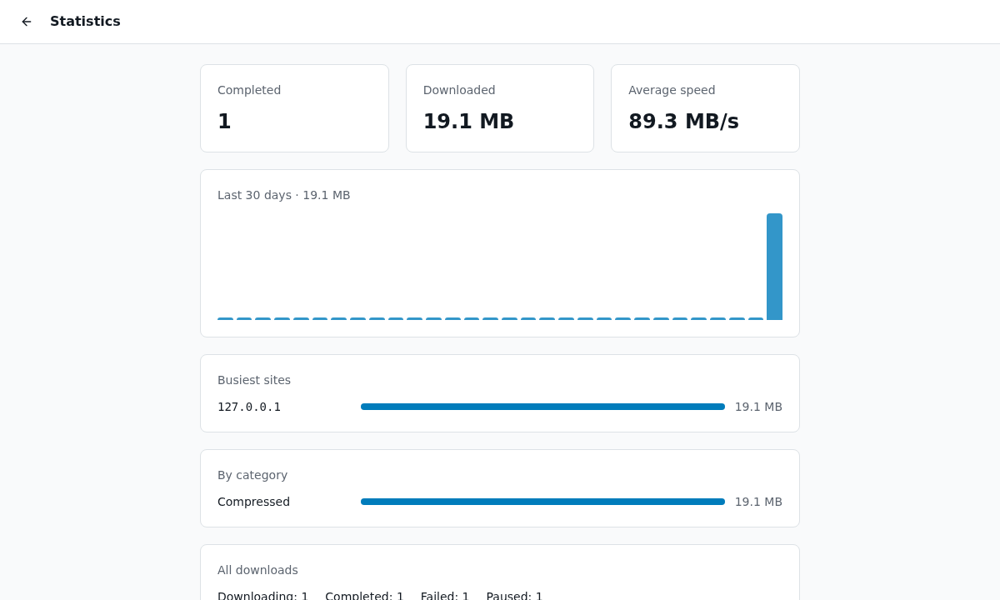
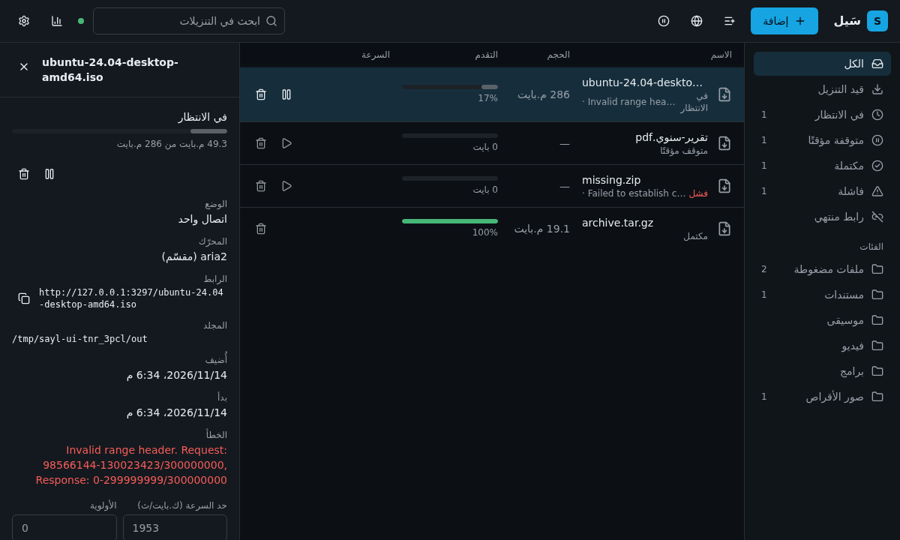

# Sayl

**English** · [العربية](#سيل)

Sayl is an open-source download manager for Linux, on X11 and Wayland. It catches the
downloads you start in your browser without any browser extension, and gives you segmented
downloads, a queue, schedules, video downloads, and the rest of what you expect from a
desktop download manager, in English and Arabic.



## Features

- **Fast downloads.** Up to 16 connections per file, resume after a crash or reboot, and
  automatic retry. A link that expires can be replaced and the download continues where it was.
- **No browser extension.** You click Download in Chrome or Firefox as usual and the file goes
  to Sayl. This works through a local proxy on your own machine. Copying a link and dropping a
  link on the floating target also work.
- **Video and audio.** Pick a quality, download playlists or only some of their items, extract
  audio, and embed subtitles (powered by yt-dlp, which Sayl keeps up to date).
- **Queue and scheduler.** Priorities, global and per-download speed limits, schedules that start
  or stop the queue or change the speed limit, and an action once the queue is done (shut down,
  suspend, or run a command).
- **Organised.** Categories with their own folders, checksum verification, history export and
  import, and statistics.
- **More ways in.** Batch downloads with number and letter ranges, a site grabber, torrents and
  magnet links, an outbound HTTP or SOCKS5 proxy, and logins for sites that need HTTP auth.
- **Desktop.** Tray icon, notifications, light and dark themes, full right-to-left Arabic.

| Add a download | Statistics |
| --- | --- |
|  |  |

## Install

Sayl needs a 64-bit Linux with glibc 2.35 or newer (Ubuntu 22.04, Debian 12, Fedora 36, or
newer). Download the `.deb` or the AppImage from the Releases page of this repository.

**Debian, Ubuntu, and derivatives**

```bash
sudo apt install ./Sayl_*_amd64.deb
```

apt installs `aria2` and `ffmpeg` with it.

**Any distribution (AppImage)**

```bash
chmod +x Sayl_*_amd64.AppImage
./Sayl_*_amd64.AppImage
```

The AppImage uses the `aria2c` and `ffmpeg` of your system. Check what is missing with
`./Sayl_*_amd64.AppImage sayl doctor`: it prints the install command for your distribution.

**From source**

```bash
git clone <this repository> && cd sayl
uv sync
uv run sayl service install       # runs sayld now and at every login
cd desktop && pnpm install && pnpm tauri dev
```

## First steps

1. Open Sayl. The first time, it sets up `sayld`, the background service that does the
   downloading, to start with your desktop session. Closing the window never stops downloads.
2. Run `sayl doctor` and install anything it marks as missing.
3. To catch browser downloads, run:

   ```bash
   sayl capture install-ca   # creates a certificate for this machine only, and trusts it
   sayl capture enable       # points your desktop's proxy setting at Sayl
   ```

   `sayl capture uninstall` puts everything back as it was.

4. Downloads you start from the app, the clipboard, the drop target, or the command line all
   land in the same list.

The [user guide](docs/USER_GUIDE.md) covers every feature and the `sayl` command line.

### Sway and other compositors without a session target

GNOME and KDE start `sayld` on their own. On sway and other wlroots compositors, add these two
lines to your configuration so `sayld` sees your display:

```text
exec systemctl --user import-environment DISPLAY WAYLAND_DISPLAY XDG_SESSION_TYPE DBUS_SESSION_BUS_ADDRESS XAUTHORITY
exec systemctl --user start sayld.service
```

## Known limits

- Downloads that a page builds with JavaScript (`blob:` or `data:` links, as MEGA does) never
  travel the network as a file, so they cannot be captured. The browser keeps handling them.
- DRM-protected services (Netflix, Shahid, Disney+, and others) are not supported, and never
  will be. Sayl reports them as protected content.
- GNOME on Wayland does not let applications watch the clipboard. Sayl checks the XWayland
  clipboard every 0.7 seconds instead, so a copied link can take up to 2 seconds to appear.

## Privacy and security

- Everything stays on your machine. `sayld`, its API, and the capture proxy listen on
  127.0.0.1 only, and the API needs a token that only your user can read.
- The capture certificate is created on your machine and never leaves it. Sayl never ships
  one. The private key is readable only by you.
- Cookies and login headers are stored encrypted with a key kept in your system keyring, and
  are never written to logs. Site passwords never leave the daemon.
- yt-dlp updates come from PyPI and are checked against PyPI's published SHA-256 hashes before
  they are used. You can turn automatic updates off in Settings.

## Uninstall

```bash
sayl capture uninstall    # restores your proxy settings and removes the certificate
sayl service uninstall    # stops sayld and removes it from your session
sudo apt remove sayl      # for the .deb, or delete the AppImage
```

Your downloads stay where they are. Settings and history are in `~/.config/sayl` and
`~/.local/share/sayl`; delete them to remove every trace.

## License

MIT. See [LICENSE](LICENSE).

---

<div dir="rtl" lang="ar">

# سيل

[English](#sayl) · **العربية**

سيل مدير تنزيلات مفتوح المصدر لنظام لينكس، يعمل على X11 وWayland. يلتقط التنزيلات التي تبدؤها في
المتصفح دون أي إضافة للمتصفح، ويقدّم لك التنزيل المجزأ وقائمة الانتظار والجدولة وتنزيل الفيديو وكل
ما تتوقعه من مدير تنزيلات لسطح المكتب، بالعربية والإنجليزية.



## المزايا

- **تنزيل سريع.** حتى 16 اتصالًا للملف الواحد، واستئناف بعد انهيار النظام أو إعادة التشغيل، وإعادة
  محاولة تلقائية. وإذا انتهت صلاحية رابط يمكنك استبداله ليكمل التنزيل من حيث توقف.
- **بلا إضافة للمتصفح.** تضغط زر التنزيل في كروم أو فايرفوكس كالمعتاد فيذهب الملف إلى سيل، عبر
  وسيط محلي يعمل على جهازك أنت. ويمكنك أيضًا نسخ الرابط أو إفلاته على الهدف العائم.
- **فيديو وصوت.** اختر الجودة، ونزّل قوائم التشغيل كاملة أو بعض عناصرها، واستخرج الصوت، وادمج
  الترجمات (بالاعتماد على yt-dlp الذي يحدّثه سيل تلقائيًا).
- **قائمة انتظار وجدولة.** أولويات، وحد للسرعة عام ولكل تنزيل، وجداول تبدأ القائمة أو توقفها أو
  تغيّر حد السرعة، وإجراء بعد انتهاء القائمة (إيقاف التشغيل أو السكون أو تشغيل أمر).
- **تنظيم.** فئات لكل منها مجلدها، والتحقق من المجموع الاختباري، وتصدير السجل واستيراده، وإحصاءات.
- **طرق أخرى للإضافة.** تنزيل دفعات بنطاقات أرقام وحروف، وجامع ملفات المواقع، والتورنت وروابط
  المغناطيس، ووسيط صادر HTTP أو SOCKS5، وبيانات دخول للمواقع التي تطلب مصادقة HTTP.
- **سطح المكتب.** أيقونة في شريط النظام، وإشعارات، وسمة فاتحة وداكنة، وواجهة عربية كاملة من اليمين
  إلى اليسار.

## التثبيت

يحتاج سيل إلى لينكس 64 بت بمكتبة glibc ‏2.35 أو أحدث (أوبونتو 22.04 أو دبيان 12 أو فيدورا 36 أو
أحدث). نزّل حزمة `.deb` أو ملف AppImage من صفحة الإصدارات (Releases) في هذا المستودع.

**دبيان وأوبونتو والتوزيعات المشتقة منهما**

<div dir="ltr">

```bash
sudo apt install ./Sayl_*_amd64.deb
```

</div>

يثبّت apt معها `aria2` و`ffmpeg`.

**أي توزيعة (AppImage)**

<div dir="ltr">

```bash
chmod +x Sayl_*_amd64.AppImage
./Sayl_*_amd64.AppImage
```

</div>

يستخدم ملف AppImage أداتي `aria2c` و`ffmpeg` المثبتتين في نظامك. لمعرفة الناقص شغّل
`./Sayl_*_amd64.AppImage sayl doctor`، فهو يطبع أمر التثبيت المناسب لتوزيعتك.

## الخطوات الأولى

1. افتح سيل. في المرة الأولى يجهّز `sayld`، وهي الخدمة الخلفية التي تتولى التنزيل، لتعمل مع جلسة
   سطح المكتب. إغلاق النافذة لا يوقف التنزيلات أبدًا.
2. شغّل `sayl doctor` وثبّت ما يظهر أنه ناقص.
3. لالتقاط تنزيلات المتصفح شغّل:

   <div dir="ltr">

   ```bash
   sayl capture install-ca
   sayl capture enable
   ```

   </div>

   ينشئ الأمر الأول شهادة خاصة بهذا الجهاز وحده ويجعلها موثوقة، ويوجّه الثاني إعداد الوسيط في سطح
   المكتب إلى سيل. والأمر `sayl capture uninstall` يعيد كل شيء كما كان.

4. كل ما تبدؤه من التطبيق أو الحافظة أو الهدف العائم أو سطر الأوامر يظهر في القائمة نفسها.

يشرح [دليل الاستخدام](docs/USER_GUIDE.md) (بالإنجليزية) كل الميزات وأوامر `sayl`.

### Sway والمراكب الأخرى التي لا تبدأ هدف الجلسة

يبدأ جنوم وكيدي خدمة `sayld` تلقائيًا. أما في sway ومراكب wlroots الأخرى فأضف هذين السطرين إلى
ملف الإعداد لترى `sayld` شاشتك:

<div dir="ltr">

```text
exec systemctl --user import-environment DISPLAY WAYLAND_DISPLAY XDG_SESSION_TYPE DBUS_SESSION_BUS_ADDRESS XAUTHORITY
exec systemctl --user start sayld.service
```

</div>

## حدود معروفة

- التنزيلات التي تبنيها الصفحة بجافاسكربت (روابط `blob:` أو `data:` كما يفعل موقع MEGA) لا تمر
  عبر الشبكة كملف، فلا يمكن التقاطها، ويستمر المتصفح في التعامل معها.
- الخدمات المحمية بإدارة الحقوق الرقمية DRM (نتفليكس وشاهد وديزني+ وغيرها) غير مدعومة ولن تكون،
  ويعرضها سيل على أنها محتوى محمي.
- لا يسمح جنوم على Wayland للتطبيقات بمراقبة الحافظة، لذا يفحص سيل حافظة XWayland كل 0.7 ثانية،
  وقد يستغرق ظهور الرابط المنسوخ ثانيتين.

## الخصوصية والأمان

- كل شيء يبقى على جهازك. تستمع `sayld` وواجهتها البرمجية ووسيط الالتقاط على العنوان 127.0.0.1
  فقط، وتتطلب الواجهة رمزًا لا يقرؤه غير مستخدمك.
- تُنشأ شهادة الالتقاط على جهازك ولا تغادره، ولا يأتي سيل بأي شهادة جاهزة. والمفتاح الخاص لا يقرؤه
  غيرك.
- تُخزَّن ملفات تعريف الارتباط وترويسات الدخول مشفرة بمفتاح محفوظ في حلقة مفاتيح النظام، ولا تُكتب
  في السجلات أبدًا. وكلمات مرور المواقع لا تغادر الخدمة.
- تأتي تحديثات yt-dlp من PyPI، ويُتحقق منها ببصمات SHA-256 المنشورة هناك قبل استخدامها. ويمكنك
  إيقاف التحديث التلقائي من الإعدادات.

## إزالة التثبيت

<div dir="ltr">

```bash
sayl capture uninstall
sayl service uninstall
sudo apt remove sayl
```

</div>

يعيد الأمر الأول إعدادات الوسيط ويزيل الشهادة، ويوقف الثاني `sayld` ويزيلها من جلستك، ويزيل الثالث
حزمة `.deb` (أو احذف ملف AppImage). تبقى ملفاتك المنزّلة في مكانها، أما الإعدادات والسجل ففي
`~/.config/sayl` و`~/.local/share/sayl`، احذفهما لإزالة كل أثر.

## الترخيص

MIT. راجع ملف [LICENSE](LICENSE).

</div>
